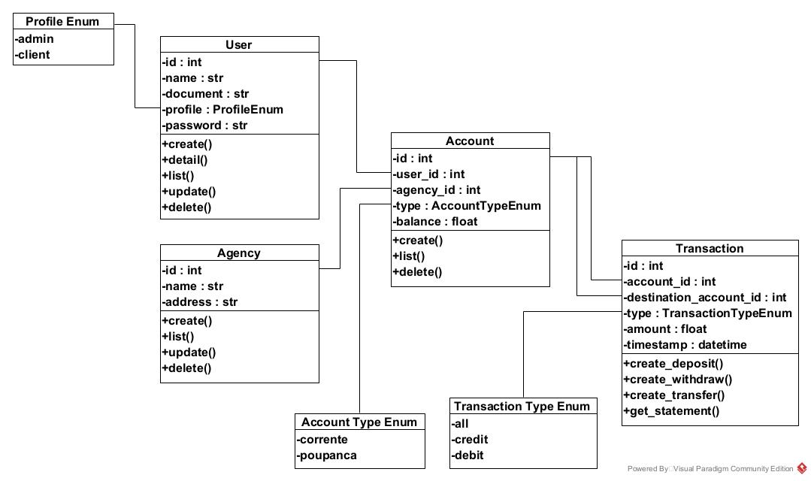

# 🏦 DIO Bank FastAPI

Uma API bancária assíncrona, robusta e escalável, desenvolvida com **FastAPI**, **Databases (asyncio/SQLite)**, **Pydantic** e autenticação **JWT**. O projeto adota arquitetura em camadas (Controllers, Services, Models, Schemas) com isolamento total de regras de negócio e validação por perfil de acesso (`admin` vs `client`).

## 📐 Diagrama de Classes (UML)



## 🛠️ Tecnologias e Ferramentas

- **Linguagem:** Python 3.10+
- **Framework Web:** FastAPI
- **Gerenciador de Dependências:** Poetry
- **Servidor ASGI:** Uvicorn
- **Persistência Assíncrona:** `database` com driver `aiosqlite`
- **Banco de Dados & ORM/Core:** SQLite / PostgreSQL, SQLAlchemy Core
- **Validação de Dados:** Pydantic v2
- **Segurança & Autenticação:** PyJWT, Passlib / OAuth2 Bearer Token
- **Testes de Integração:** Pytest, Pytest-Asyncio, HTTPX (`AsyncClient`)


## 📂 Estrutura do Projeto

A arquitetura segue uma divisão clara de responsabilidades no padrão MVC/Clean Architecture adaptado para APIs:

```text
DIO_Bank_FastAPI/
├── src/
│   ├── controllers/      # Handlers de rota (endpoints HTTP)
│   │   ├── account.py
│   │   ├── agency.py
│   │   ├── auth.py
│   │   ├── transaction.py
│   │   └── user.py
│   ├── models/           # Definição das tabelas SQLAlchemy/Core
│   ├── schemas/          # Schemas Pydantic (Validação/DTOs)
│   ├── services/         # Camada de Regras de Negócio e Persistência
│   ├── views/            # Formatação de respostas JSON para apresentação
│   ├── config.py         # Configurações globais e variáveis de ambiente
│   ├── database.py       # Instância e conexão assíncrona do banco
│   ├── exceptions.py     # Tratametno customizado de exceções HTTP
│   ├── main.py           # Ponto de entrada da aplicação FastAPI
│   └── security.py       # Lógica de JWT e controle de permissões
├── tests/
│   └── integration/
│       └── controllers/  # Suíte completa de testes de integração (76 testes)
│           ├── account/
│           ├── agency/
│           ├── auth/
│           ├── transaction/
│           └── user/
├── alembic.ini           # Configuração de migrações
├── pyproject.toml        # Configuração de dependências via Poetry
├── diobank.db            # Banco SQLite local
├── .gitignore
└── README.md
```

## 🚀 Como Executar o Projeto
### Pró-requisitos
* Python 3.10 ou superior
* Poetry instalado
* Git instalado

### 1. Clonar e Instalar Dependências
```
Bash

git clone [https://github.com/seu-usuario/DIO_Bank_FastAPI.git](https://github.com/seu-usuario/DIO_Bank_FastAPI.git)
cd DIO_Bank_FastAPI

# Instalar dependências via Poetry
poetry install
```

### 2. Configurar Variáveis de Ambiente
```
Snippet de código

DATABASE_URL=sqlite:///./diobank.db
SECRET_KEY=sua_chave_secreta_jwt
ALGORITHM=HS256
ACCESS_TOKEN_EXPIRE_MINUTES=30
```

### 3. Executar as Migrações
```
Bash

poetry run alembic upgrade head
```

### 4. Executar a aplicação
```
Bash

poetry run uvicorn src.main:app --reload
```


## 📑 Documentação Interativa (Swagger / Redoc)
Com o servidor rodando, acesse a documentação gerada automaticamente pelo FastAPI:
* __Swagger UI__: `http://127.0.0.1:8000/docs`
* __ReDoc__: `http://127.0.0.1:8000/redoc`

## 🧪 Suíte de Testes de Integração
A aplicação conta com 100% de aprovação nos 76 testes de integração, cobrindo o fluxo completo de todas as entidades e controladores:

```
Bash
poetry run pytest tests/integration/controllers -v
```

### Resumo do Log de Execução (76/76 Passed):
* __User Controller (18 testes)__: Criação, listagem, leitura, atualização e deleção; tratamento de documentos duplicados e permissões por perfil (client vs admin).
* __Agency Controller (17 testes)__: CRUD completo com validação de duplicidade de nome/agência e bloqueios de perfil.
* __Account Controller (12 testes)__: Regra de conta corrente única por usuário, validação de saldo zerado antes da exclusão e tratamentos de autorização `403`.
* __Transaction Controller (27 testes)__: Depósitos, saques com validação de saldo insuficiente, transferências entre contas distintas e extratos com filtros por tipo (`credit`, `debit`, `all`).
* __Auth Controller (2 testes)__: Autenticação JWT com credenciais válidas e inválidas.

